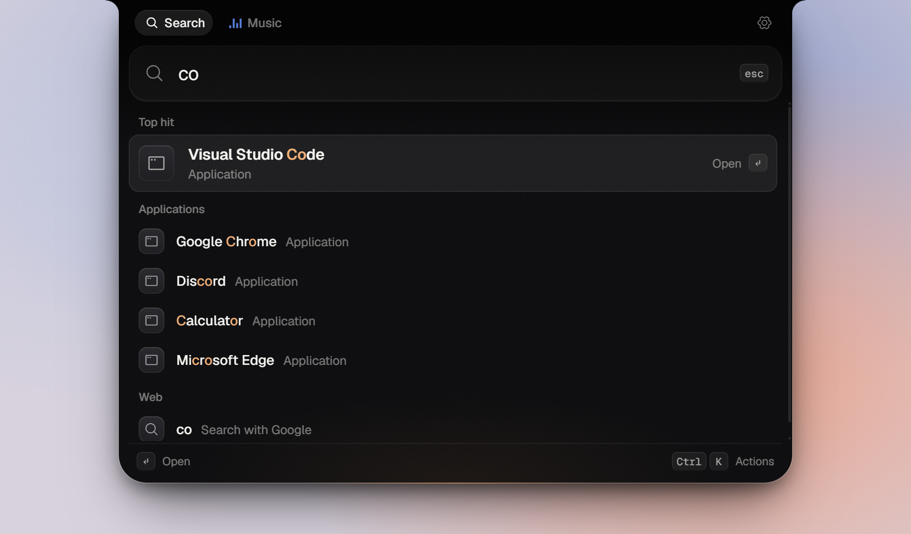
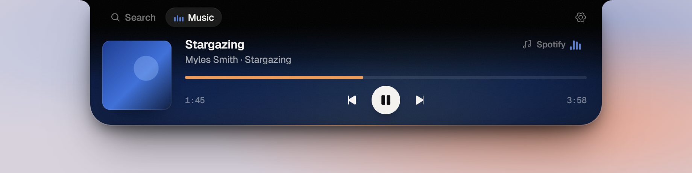
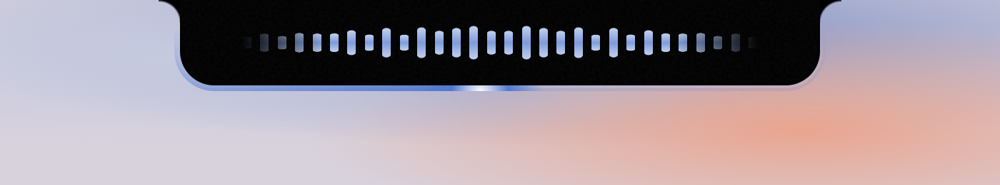
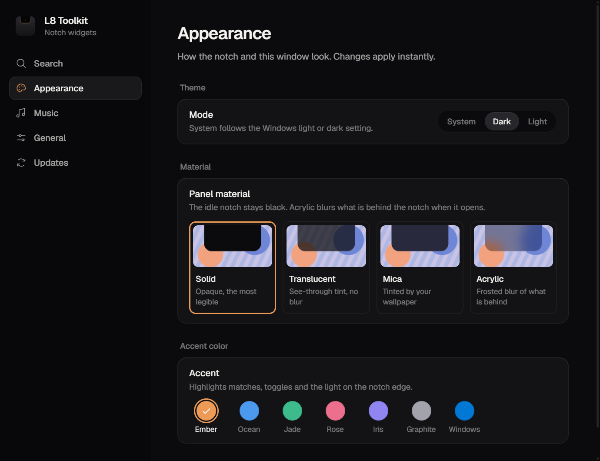

# L8 Toolkit

A tray app that hosts small widgets inside a **virtual notch** at the top of the screen.
The notch idles as a small black shape against the bezel and pours open into a panel.

<p align="center">
  
</p>

<p align="center">
  
</p>

<p align="center">
  
</p>

<p align="center">
  
</p>

Widgets:
- **Spotlight**: a launcher that searches apps, files, folders, the web, and does quick math.
- **Music**: whatever plays in Spotify, a browser (YouTube...) or any media app, read from the
  Windows media sessions. While something plays, the folded notch shows a live activity: a light
  along its edge traces the track progress, and audio bars in its middle move with the sound
  (read from the speakers through WASAPI loopback, see `src-tauri/src/audio/`). It can briefly
  expand on track changes; the Music tab has the cover, a wavy seekable progress line and the
  controls, all in the colors of the cover.
- **Quick Accent**: hold a letter and press `Space`, `←` or `→`: its accented characters drop out
  of the notch; move with the same keys (`Shift+Space` goes back, `Esc` cancels) and release the
  letter to type the chosen one, in any app. 29 languages plus currencies and symbols, chosen in
  Settings › Quick Accent (`src-tauri/src/quick_accent/`).
- **Timer**: a countdown (presets, `↑` `↓` or the mouse wheel to adjust) or a Pomodoro (focus,
  short and long breaks, set in Settings › Timer). It keeps running with the notch closed: the
  folded notch shows the time left and its light fills as time passes; a Windows notification
  and a short peek announce the end (`src-tauri/src/timer/`).

- **Recents**: the last texts, images, screenshots and files copied (10 by default, kept across
  restarts), plus files dropped on the notch (a shelf: drag a file onto the notch, switch windows,
  drag it out later). Click an item to copy it again, drag it into any app, or open it. Files with a
  Windows thumbnail (photos, videos) show it on their card. A new screenshot briefly shows in the notch. Copies from password managers (Bitwarden, 1Password,
  KeePass...) are kept but never shown in clear, and are encrypted with DPAPI on disk; a setting
  leaves them out entirely (`src-tauri/src/recents/`). Browser extensions copy through the browser,
  which marks nothing, so texts that look like a password, an API key or a token are masked too
  (`recents/secret.rs`). WebView2 refuses file drops, so the shelf uses a native drop window laid over
  the notch while a drag comes in (`platform/win32/drop_zone.rs`).

When music plays and a timer runs at the same time, the activity you looked at last takes the
notch and the other one moves to a small bubble beside it, with its progress as a ring. Resting the
pointer on the bubble opens the panel on that activity.

While a fullscreen app (a game, a video) has the focus, the search shortcut is released to it and
Quick Accent lets every key through, so playing never opens the notch by accident (Settings ›
General › Games and fullscreen, `src-tauri/src/fullscreen_pause.rs`).

Switch widgets with the tabs, `Alt+←` / `Alt+→`, or `Alt+1` to `Alt+4` (Search, Music, Timer, Recents).
The interface is available in English and French (Settings > General > Language; "System" follows
Windows). Strings live in `src/i18n/messages/` (web) and `src-tauri/src/i18n/` (Rust); both
catalogs are type-checked so a missing translation does not compile. Hovering a notch that is playing opens Music;
the keyboard shortcut opens Search. In Music: `Space` play/pause, `←` `→` seek, `Ctrl+←` `Ctrl+→`
previous/next, click the cover or the app name to bring the player to the front. In Timer: `Space`
or `Enter` start/pause, `↑` `↓` adjust (or add/remove a minute while running), `Delete` stops,
`Ctrl+→` skips to the next Pomodoro phase. In Recents: `←` `→` select (`Home` / `End` jump to the
ends, the mouse wheel scrolls), `Enter` copies, `Ctrl+Enter` opens, `Delete` removes; Settings › Recents lists
them.

## Install

Download `L8Toolkit_<version>_x64-setup.exe` from the
[latest release](https://github.com/leeBrown71309/L8Toolkit/releases/latest) and run it. It installs
for the current user (no administrator rights). Later versions install from **Settings › Updates**.

The installer is not code-signed yet, so Windows SmartScreen may show "Windows protected your PC":
choose **More info › Run anyway**.

## Requirements (development)

- Windows 10/11 with WebView2 (preinstalled on Windows 11)
- [Rust](https://rustup.rs) 1.90+ with the MSVC toolchain
- [Bun](https://bun.sh)
- [GitHub CLI](https://cli.github.com) for the release scripts

## Development

```powershell
bun install
bun run app:dev      # the test copy, with hot reload
bun run app:build    # build an installer locally (needs the signing key, see docs/releasing.md)
```

Two copies of the app exist and never share anything:

| | Release | Test copy |
| --- | --- | --- |
| Started by | the installer, the Start menu, sign-in | `bun run app:dev` |
| Name and tray tooltip | L8 Toolkit | L8 Toolkit Dev (blue notch icon, "Test version" in Settings) |
| Data | `com.l8.toolkit` | `com.l8.toolkit.dev` |
| Updates | Settings › Updates | none (it is the code being written) |

Only one can run at a time (both draw a notch and use the same shortcut): `app:dev` stops the
installed release first. When a feature is merged and released:

```powershell
bun run dev:remove        # removes the test copy (keeps its settings for next time)
bun run release:install   # installs the latest release if it is missing or older
```

| Action | How |
| --- | --- |
| Open / close Spotlight | `Alt+Space` (configurable), rest the pointer on the notch, click the tray icon, or run `l8-tools-kits.exe --toggle-search` |
| Move selection | `↑` `↓` (`←` `→` on the Frequent row) |
| Open | `Enter` |
| All actions of a result | `Ctrl+K`, `Tab`, or right-click |
| Clear / close | `Esc` (closes the action menu first) |
| Settings | `Ctrl+,`, the gear in the notch, or the tray menu |

Actions, also usable directly from the search field:

| Action | Shortcut | Available on |
| --- | --- | --- |
| Run as administrator | `Ctrl+Shift+Enter` | apps, executables |
| Show in folder | `Ctrl+Enter` | apps, files, folders |
| Open with… | `Ctrl+O` | files |
| Open in Terminal | `Ctrl+T` | files (parent folder), folders |
| Properties | `Alt+Enter` | apps, files, folders |
| Copy path / link | `Ctrl+Shift+C` | apps, files, folders, web |
| Copy file (paste it in Explorer) | menu | files, folders |
| Pin to / unpin from Frequent | `Ctrl+P` | apps, files, folders |
| Move to Recycle Bin (press twice) | `Ctrl+Shift+Delete` | files, folders |
| Paste a calculation in the previous app | `Ctrl+Enter` | calculator |
| Uninstall or modify | menu | apps |

## Appearance

Settings > General: theme (system, dark, light), accent color (six presets or the Windows
accent), and the panel material. The idle notch always stays black.

| Material | How it is drawn |
| --- | --- |
| Solid | Opaque surface (default) |
| Translucent | See-through tint, live, no blur |
| Mica | The desktop wallpaper, blurred and tinted (what real Mica samples) |
| Acrylic | A snapshot of the screen behind the notch taken as it opens, frosted |

Windows' native Mica/Acrylic backdrops cannot be used: they ignore custom window shapes and
paint the whole rectangular window (verified with `SetWindowRgn`), so the notch renders its
materials itself. See `src-tauri/src/backdrop.rs`.

## Architecture

```
src-tauri/src/            Rust core
  lib.rs                  app setup, plugins, command registration
  notch.rs                notch window: placement, open/collapse, hover, drop zone, fullscreen watcher
  hotkey.rs               global shortcut registration
  fullscreen_pause.rs     releases the shortcut and Quick Accent to fullscreen apps (games)
  search/                 pure search logic (no Tauri types, unit tested)
    service.rs            ranking across apps, files, commands; top hit selection
    matching.rs           nucleo fuzzy matching + launcher bonuses (prefix, acronym)
    apps.rs / files.rs    app and file indexes
    calculator.rs         arithmetic parser
    web.rs                URL detection, search engine URLs
  platform/               OS layer (Win32 today, stubs for macOS/Linux)
  icons/                  shell icon extraction on a COM worker thread, PNG encoding
  actions.rs              what each result action does (open, elevate, reveal, recycle...)
  backdrop.rs             wallpaper (Mica) and screen snapshot (Acrylic) images
  media.rs                now playing: session watcher, change detection, playback commands
  audio/                  audio bars: loopback capture loop, FFT band levels (spectrum.rs)
  quick_accent/           Quick Accent: keyboard hook logic (machine.rs), accents per language
  recents/                clipboard history and shelf: list logic (list.rs), clipboard images (image.rs)
  timer/                  timer and Pomodoro: pure logic (machine.rs), deadline watcher, notification
  updates.rs              in-app updates: periodic check, notification, signed install
  appearance.rs           window theme for the light/dark setting
  indexer.rs              background (re)indexing every 15 minutes
  settings*.rs, usage.rs  persisted settings, launch history and pins (JSON)
src/                      React UI (one bundle, two windows)
  styles/tokens.css       design tokens: dark/light themes, materials, accent
  widgets/notch/          the morphing notch shape, widget tabs, open/close/peek logic
  widgets/spotlight/      the search panel, result actions and action menu
  widgets/music/          live activity, music panel, progress bar, cover glow color
  widgets/timer/          timer panel, timer live activity and bubble
  widgets/recents/        Recents cards, drag out, drop zone, screenshot peek
  settings/               settings window
  shared/                 typed IPC layer, browser preview backend
```

**Why Tauri:** Rust handles everything performance-sensitive (indexing, fuzzy search, icon
extraction, Win32 integration) while the UI uses web rendering for the visual polish.
Memory stays low: one WebView2 for the notch, the settings window only exists while open.

**How the notch works:** the native window is a fixed, transparent, always-on-top canvas that
is click-through while idle. The notch shape is drawn with CSS clip paths driven by registered
custom properties (`@property`), so it morphs smoothly without ever resizing the native window.
A 50 ms pointer poll (no global mouse hook) detects hovering; the notch hides when a fullscreen
app covers its monitor.

## Design preview in a browser

`bun run dev` then open `http://localhost:1420` (notch) or `http://localhost:1420/?window=settings`.
Outside Tauri, a mock backend with sample data is used. Open the notch from the console:
`window.l8Preview.emit("notch:opened", { source: "hotkey" })`.

## Checks

```powershell
bun run typecheck
bun run test
bun run build
cd src-tauri; cargo test; cargo clippy --all-targets -- -D warnings
```

Pull requests into `main` run the same checks on GitHub (`.github/workflows/ci.yml`); merging
publishes a release when the version was bumped (see [docs/releasing.md](docs/releasing.md)).

## Data

The test copy uses the same layout under `com.l8.toolkit.dev`.

- Settings: `%APPDATA%\com.l8.toolkit\settings.json`
- Launch history: `%APPDATA%\com.l8.toolkit\usage.json`
- Recents: `%APPDATA%\com.l8.toolkit\recents\` (list and images)
- Logs: `%LOCALAPPDATA%\com.l8.toolkit\logs`

## License

[MIT](LICENSE)
